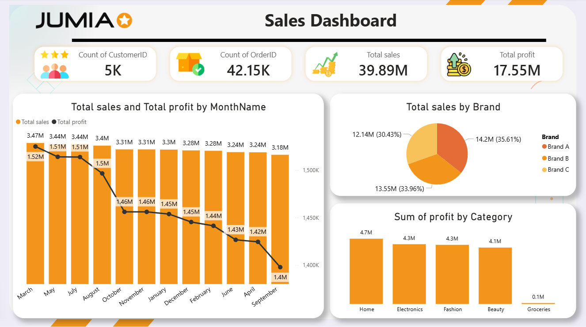
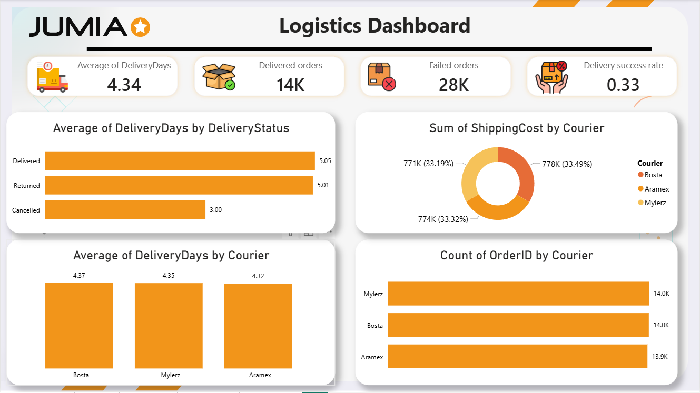
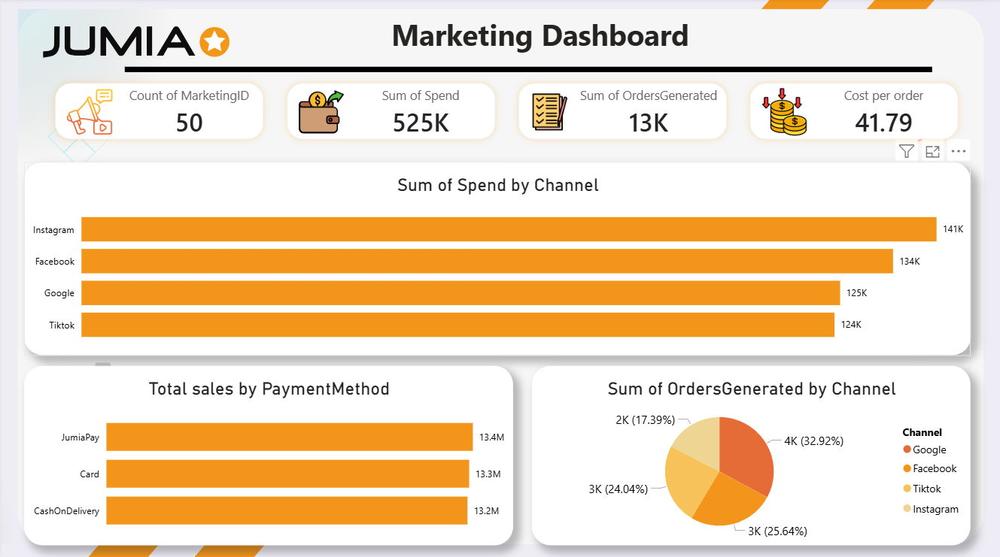
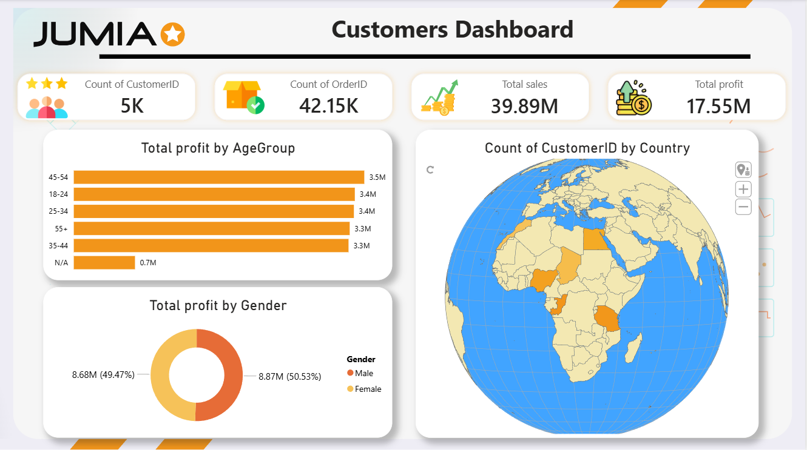

# Jumia E-commerce Performance Dashboard

Interactive Power BI dashboard that analyzes Jumia's sales, logistics, marketing and customer data across 4 pages.

## Business Questions
- How are sales and profit trending month over month?
- Which brands and categories drive the most profit?
- How efficient are the delivery couriers, and why do orders fail?
- Which marketing channels bring the most orders per spend?
- Who are the customers (age, gender, country)?

## Tools
- Power Query (data cleaning and transformation)
- Power BI (data modeling, DAX measures, visuals)

## Dashboard Pages

### 1. Sales

- 5K customers, 42.15K orders, 39.89M total sales, 17.55M total profit
- Sales and profit decline gradually from March to September
- Home is the top category by profit (4.7M), while Groceries is almost negligible (0.1M)
- Brand A leads sales with 35.6%

### 2. Logistics

- Average delivery time: 4.34 days
- The 3 couriers (Bosta, Mylerz, Aramex) perform almost the same in delivery time, cost and order volume
- Only 14K of 42K orders were delivered successfully

### 3. Marketing

- 525K total spend across 50 campaigns, with a cost per order of 41.79
- Instagram has the highest spend (141K) but generates the fewest orders (17.4%)
- Google generates the most orders (32.9%)

### 4. Customers

- Profit is spread evenly across age groups, with 45-54 slightly ahead
- Gender split is almost 50/50
- Customers come from Egypt, Morocco, Nigeria, Chad, Congo and Tanzania

## Key Takeaways
- Reallocating part of the Instagram budget to Google could lower the cost per order
- The high failed-order rate is the biggest operational issue
- Sales and profit are declining, which needs further investigation

## Dataset
The dataset was sourced from [Kaggle](https://www.kaggle.com/).

## Author
**Radwa Khater** | Data Analyst
[LinkedIn](https://www.linkedin.com/in/radwa-khater)
